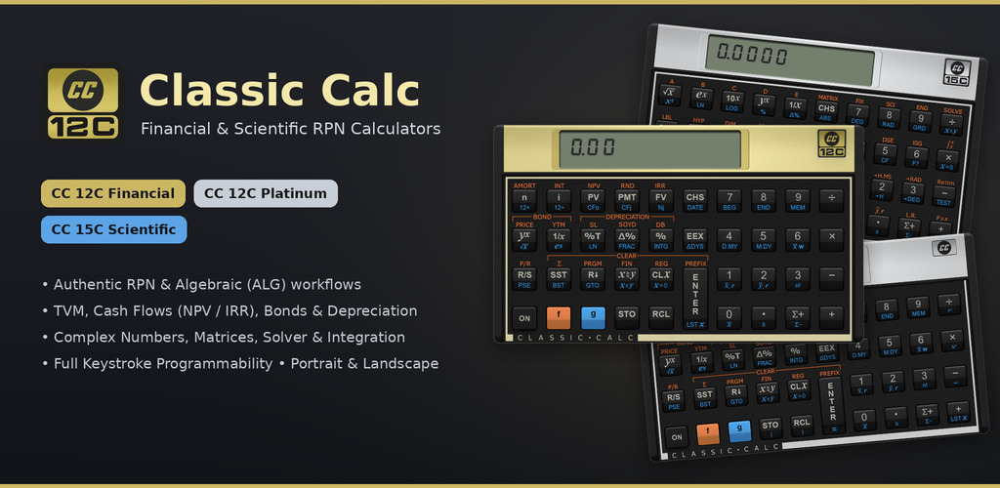
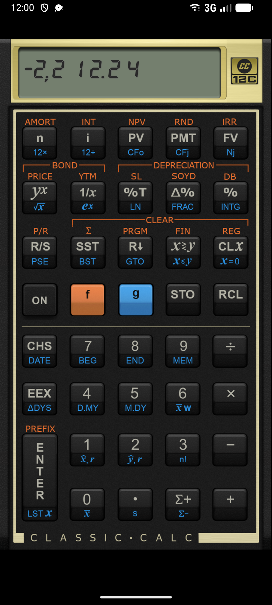
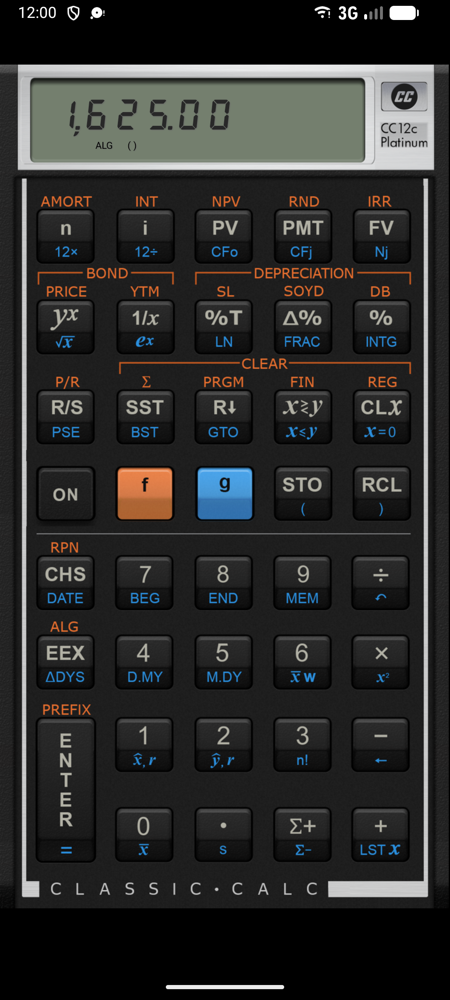
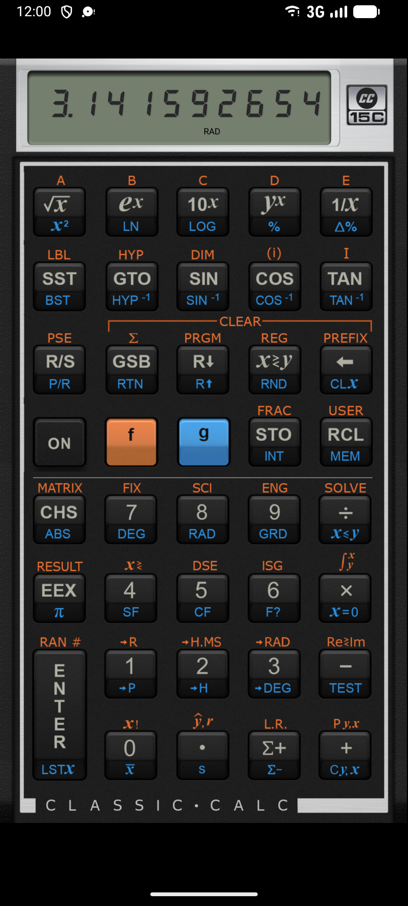
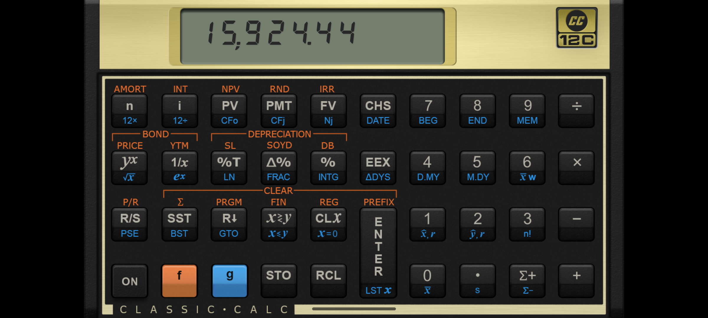
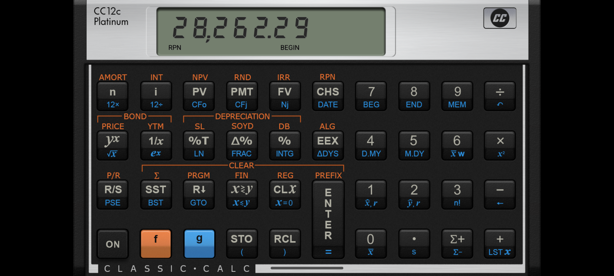
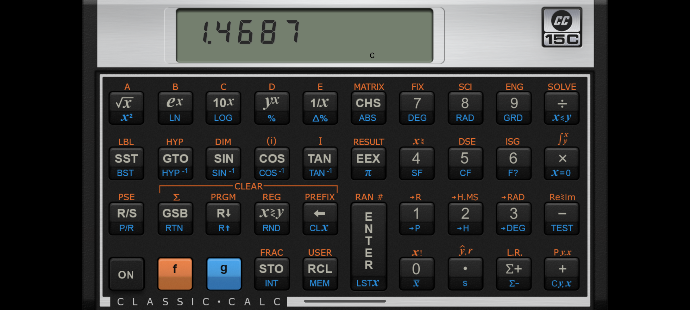
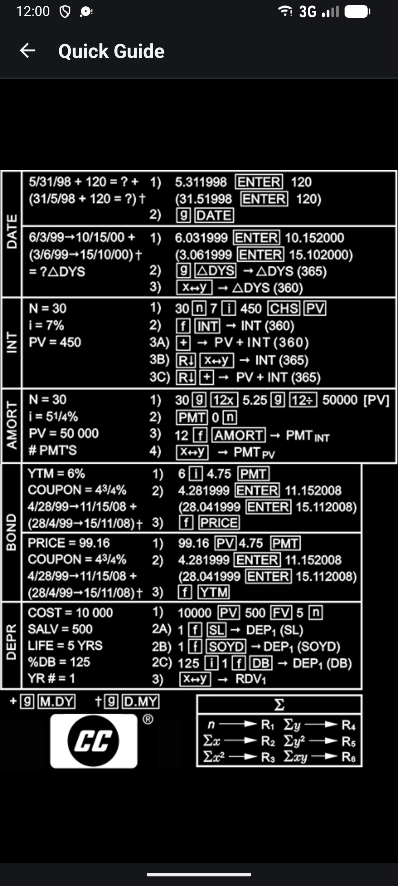
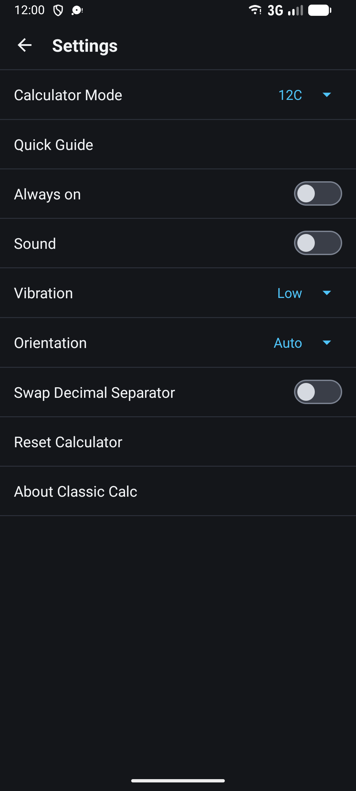

# Classic Calc

**Classic Calc** (`org.liberty.android.classiccalc`) is an Android calculator application that faithfully reproduces three classic Voyager-series financial and scientific calculators in a single pure-Java Android app:

- **CC 12C Financial** — Classic RPN financial calculator
- **CC 12C Platinum** — Enhanced financial calculator supporting both **RPN** and **Algebraic (ALG)** operating modes, expanded memory, and additional functions
- **CC 15C Scientific** — Advanced RPN scientific programmable calculator

---

## Screenshots

### Portrait Layouts (Full 39-Key Faceplates)

| CC 12C Financial (TVM) | CC 12C Platinum (ALG & `( )`) | CC 15C Scientific (`RAD` & $\pi$) |
| :---: | :---: | :---: |
|  |  |  |

### Landscape Layouts (Classic Voyager Faceplates)

| CC 12C Financial (`NPV` Cash Flow) | CC 12C Platinum (`RPN` & `BEGIN`) |
| :---: | :---: |
|  |  |

| CC 15C Scientific (Complex Mode `C`) |
| :---: |
|  |

### Quick Guide & Settings

| Quick Guide Reference Plate | Settings |
| :---: | :---: |
|  |  |

---

## Features & Calculator Modes

### 1. CC 12C Financial (`CC_12C`)
- **Reverse Polish Notation (RPN)** workflow with 4-level stack ($X, Y, Z, T$) and `LSTx`.
- **Time Value of Money (TVM)**: $n$, $i$, $PV$, $PMT$, $FV$, with `BEGIN`/`END` payment modes and compound/simple interest indicator (`C`).
- **Cash Flow Analysis**: Discounted cash flows ($CF_0$, $CF_j$, $N_j$), Net Present Value (`NPV`), and Internal Rate of Return (`IRR`).
- **Amortization, Bonds & Depreciation**: `AMORT`, bond `PRICE` and `YTM`, straight-line (`SL`), sum-of-years'-digits (`SOYD`), and declining-balance (`DB`) depreciation.
- **Date Arithmetic**: Actual and 360-day calendar calculations (`DATE`, `ΔDYS`) in `M.DY` or `D.MY` format.
- **Percentages & Statistics**: `%`, `Δ%`, `%T`, two-variable statistics ($\Sigma+$, $\Sigma-$, $\bar{x}$, $s$, weighted mean $\bar{x}_w$, linear regression $\hat{y}, r$ and $\hat{x}, r$).
- **Keystroke Programming**: Record, step (`SST`, `BST`), and execute (`R/S`) keystroke programs with conditional tests ($x \le y$, $x = 0$) and `GTO`.

### 2. CC 12C Platinum (`CC_12CP`)
- Includes all **CC 12C** financial, statistical, date, and programming functions plus:
- **Dual Operating Modes**: Switch between **RPN** (`f RPN`) and **Algebraic** (`f ALG`) modes with parenthesized expressions `( )`.
- **Additional Math Functions**: Square ($x^2$) and Undo/Backspace support.
- **Expanded Program & Register Capacity**: Larger keystroke program memory and register storage with full storage register arithmetic (`STO +`, `STO -`, `STO ×`, `STO ÷`).

### 3. CC 15C Scientific (`CC_15C`)
- **Scientific & Trigonometric Functions**: $\sin, \cos, \tan$, inverse trig ($\text{SIN}^{-1}, \text{COS}^{-1}, \text{TAN}^{-1}$), hyperbolic functions (`HYP`), degrees (`DEG`), radians (`RAD`), and grads (`GRD`).
- **Logarithmic, Exponential & Power Functions**: $\sqrt{x}, e^x, \ln, 10^x, \log, y^x, 1/x, \%, \Delta\%$.
- **Complex Numbers, Matrices & Calculus/Solver**: Full support for complex stack mode (`I`, `Re≷Im`), matrix operations (`MATRIX`), numerical root solving (`SOLVE`), and numerical integration ($\int_y^x$).
- **Combinatorics, Probability & Conversions**: Factorial ($x!$), permutations ($P_{y,x}$), combinations ($C_{y,x}$), random number generator (`RAN#`), polar/rectangular conversions ($\rightarrow P, \rightarrow R$), and angle/time conversions ($\rightarrow \text{H.MS}, \rightarrow \text{H}, \rightarrow \text{RAD}, \rightarrow \text{DEG}$).
- **Full Keystroke Programmability**: Labels (`LBL`), subroutines (`GSB`, `RTN`), flags, loop control (`ISG`, `DSE`), and indirect addressing (`(i)`, `I`).

---

## User Interface & Controls

- **Full-Function Portrait & Landscape Layouts**: Dedicated high-resolution 39-key faceplates in both portrait (top/bottom 5×4 split) and classic Voyager landscape (10×4) orientations across all three calculator modes.
- **Tactile Key Response**: Plays audio/haptic feedback immediately on key press (and **CC** badge tap) while registering keystrokes cleanly on key release.
- **Interactive LCD**: Custom 7-segment LCD rendering (`fonts/calc_font.ttf`) with active status annunciators (`-`, `*`/`|`, `USER`/`RPN`/`ALG`, `( )`, `f`, `g`, `BEGIN`, `G`/`RAD`, `D.MY`, `C`, `PRGM`).
- **Dynamic Launcher Icon**: Automatically updates the app launcher icon to match the selected calculator mode (`12C`, `12C Platinum`, or `15C`).
- **Automatic State Persistence**: Stack contents, financial registers, storage registers, modes, and programs are automatically saved on pause/exit and restored on launch for each calculator mode independently.

---

## Settings

Accessible by tapping the **CC** badge at the top right of the calculator faceplate:

- **Calculator Mode**: Switch seamlessly between **12C**, **12C Platinum**, and **15C**.
- **Quick Guide**: View the built-in quick reference back-cover plate for the active calculator mode.
- **Always on**: Keep the screen awake while the calculator is open (default off).
- **Sound**: Enable or disable audible key click feedback on key press.
- **Vibration**: Configure haptic feedback intensity on key press (`Off`, `Low`, `Medium`, `High`).
- **Orientation**: Choose between `Auto` (full sensor), `Lock Landscape`, or `System`.
- **Swap Decimal Separator**: Toggle the decimal point and thousands separator between US (`1,234.56`) and European (`1.234,56`) formats.
- **Reset Calculator**: Clear and reset the active calculator's memory to factory defaults.
- **About Classic Calc**: View version details and project repository link.

---

## Developer Documentation

See [`DEV.md`](DEV.md) for details on the codebase structure, engine architecture, display protocol, build commands, and unit test suite.
